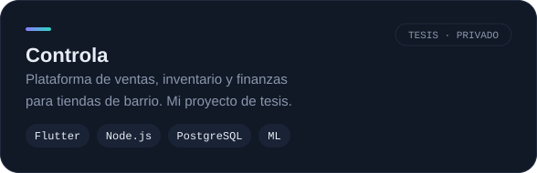
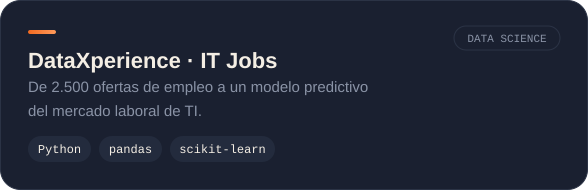
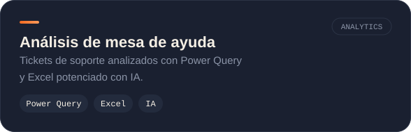
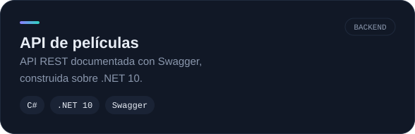
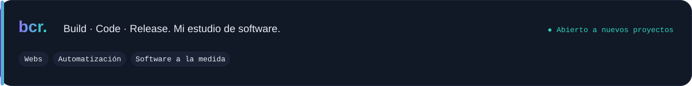
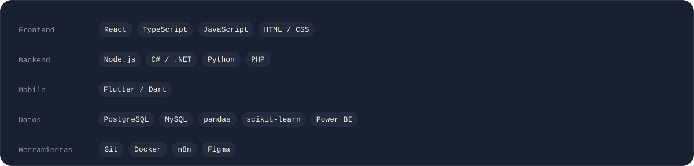

<picture><source media="(prefers-color-scheme: dark)" srcset="assets/hero-dark.svg"><source media="(prefers-color-scheme: light)" srcset="assets/hero-light.svg"></picture>

[LinkedIn](https://www.linkedin.com/in/nicolas-felipe-becerra-jimenez-771a83263/) · [Correo](mailto:nbecerran73@gmail.com) · [bcr.](#-bcr)

## 👋 Hola

Soy ingeniero de sistemas en último semestre (Universidad EAN, Bogotá). Diseño y construyo software para negocios reales: apps, APIs, análisis de datos y automatizaciones. Mi proyecto de tesis, **Controla**, es una plataforma para tiendas de barrio; y con **bcr.** llevo ese mismo enfoque a clientes.

## 🚀 Proyectos

<table><tr>
<td><a href="https://github.com/nicobcra"><picture><source media="(prefers-color-scheme: dark)" srcset="assets/card-controla-dark.svg"><source media="(prefers-color-scheme: light)" srcset="assets/card-controla-light.svg"></picture></a></td>
<td><a href="https://github.com/nicobcra/Project-DataXperience-IT_Jobs"><picture><source media="(prefers-color-scheme: dark)" srcset="assets/card-itjobs-dark.svg"><source media="(prefers-color-scheme: light)" srcset="assets/card-itjobs-light.svg"></picture></a></td>
</tr><tr>
<td><a href="https://github.com/nicobcra/analisis-mesa-ayuda-excel-ia"><picture><source media="(prefers-color-scheme: dark)" srcset="assets/card-helpdesk-dark.svg"><source media="(prefers-color-scheme: light)" srcset="assets/card-helpdesk-light.svg"></picture></a></td>
<td><a href="https://github.com/nicobcra/APIpeliculas_Swagger"><picture><source media="(prefers-color-scheme: dark)" srcset="assets/card-api-dark.svg"><source media="(prefers-color-scheme: light)" srcset="assets/card-api-light.svg"></picture></a></td>
</tr></table>

> El código de **Controla** es privado (es parte de mi tesis). Escríbeme si quieres ver una demo.

## 🏢 bcr.

<picture><source media="(prefers-color-scheme: dark)" srcset="assets/bcr-dark.svg"><source media="(prefers-color-scheme: light)" srcset="assets/bcr-light.svg"></picture>

## 🧰 Stack

<picture><source media="(prefers-color-scheme: dark)" srcset="assets/stack-dark.svg"><source media="(prefers-color-scheme: light)" srcset="assets/stack-light.svg"></picture>

## 📬 Hablemos

Estoy abierto a oportunidades de desarrollo de software y a proyectos con **bcr.** Escríbeme a [nbecerran73@gmail.com](mailto:nbecerran73@gmail.com) o por [LinkedIn](https://www.linkedin.com/in/nicolas-felipe-becerra-jimenez-771a83263/).
